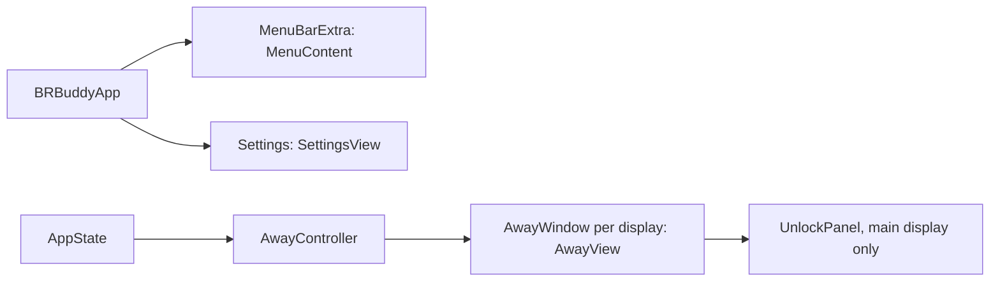
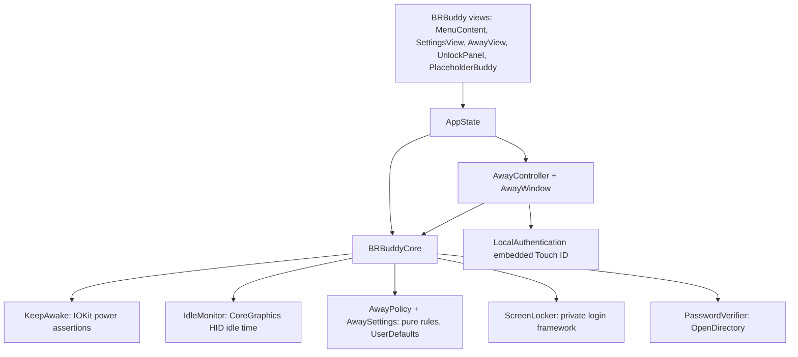

# BRBuddy architecture map

The plumbing guide: **where things live and how they connect**. Read this first, then the flow page for the journey
you're working on (`flows/`). For what's planned and why, see `ROADMAP.md`. The plain-English support guide
(`docs/support-guide.md`) and the visual `map.html` come before the first public release.

> **Depth:** this map names files and types, never functions. Function names change; open the files listed under
> "Code to check" and read the current code before relying on any detail here.

## What the app is
A macOS 14+ menu bar app that keeps the Mac awake while an AI coding agent works, and covers every display with an
away screen ("BRB") that needs Touch ID or the login password to dismiss. BRB starts from the menu, a global
shortcut, or by itself after a few minutes with no input while keep-awake is on, and hands off to the real macOS lock
screen after failed unlocks or a long time away. Everything runs locally; there is no server. Distributed outside the
App Store and not sandboxed.

## Scenes / surfaces

| Surface | What it is | Made by |
|---|---|---|
| Menu bar item | Paw icon (filled while keeping awake): keep-awake toggle, BRB now, Settings, Quit | `BRBuddyApp` showing `MenuContent` |
| Settings window | When BRB starts, when it locks for real, shortcut, launch at login | `BRBuddyApp`'s Settings scene showing `SettingsView` |
| Away windows | One borderless window per display at screen-saver level, on every Space | `AwayController` makes `AwayWindow`s hosting `AwayView` |

No Dock icon or main window: `LSUIElement` in `Config/Info.plist`, and `BRBuddyApp` sets the accessory activation
policy for `swift run`.

## Layers

Two SwiftPM targets. `BRBuddyCore` holds system wrappers and pure logic with no UI, and is what `BRBuddyTests`
tests. `BRBuddy` is the app: SwiftUI views, `AppState`, `AwayController` and `AwayWindow`. The only package
dependency is KeyboardShortcuts (MIT), used by the app target for the global BRB shortcut and its recorder.

## Who owns what
| Type | File | Created by / lifetime | Isolation / thread | Job |
|---|---|---|---|---|
| `BRBuddyApp` | `BRBuddy/BRBuddyApp.swift` | System, app lifetime | Main actor | Entry point; menu bar and Settings scenes; reads `AppState` from `AppDelegate` |
| `AppDelegate` | `BRBuddy/AppDelegate.swift` | SwiftUI delegate adaptor, app lifetime | Main actor | Owns `AppState`; refuses to quit while BRB is up; debug-only launch hooks |
| `AppState` | `BRBuddy/AppState.swift` | `AppDelegate`, app lifetime | `@MainActor`, `@Observable` | Owns `KeepAwake`, `AwayController`, settings, the 5-second idle check, the global shortcut, launch at login |
| `AwayController` | `BRBuddy/AwayController.swift` | `AppState`, app lifetime | `@MainActor`, `@Observable` | Runs BRB: windows, presentation options, focus guard, unlock, failures, escalation, 1-second ticker |
| `AwayWindow` | `BRBuddy/AwayWindow.swift` | `AwayController`, one per display while away | Main thread (AppKit) | Borderless key-capable window; reports input; swallows Command shortcuts |
| `AwayView` | `BRBuddy/AwayView.swift` | `AwayController`, hosted in each `AwayWindow` | Main actor (view) | Companion, tagline, time away, footer per phase |
| `UnlockPanel` | `BRBuddy/UnlockPanel.swift` | `AwayView` on the main display while unlocking | Main actor (view); password check on a detached task | Embedded Touch ID view and password field |
| `PlaceholderBuddy` | `BRBuddy/PlaceholderBuddy.swift` | `AwayView` | Main actor (view) | Code-drawn stand-in companion until packs arrive |
| `MenuContent` | `BRBuddy/MenuContent.swift` | `BRBuddyApp`'s menu scene | Main actor (view) | Menu items |
| `SettingsView` | `BRBuddy/SettingsView.swift` | `BRBuddyApp`'s Settings scene | Main actor (view) | Edits `AwaySettings` through `AppState` |
| `KeepAwake` | `BRBuddyCore/KeepAwake.swift` | `AppState`, app lifetime | Used from the main actor | Holds at most one IOKit power assertion; released on `deinit` |
| `AwaySettings` | `BRBuddyCore/AwaySettings.swift` | Value, held by `AppState` and copied into `AwayController` at start | Value type | Preferences; loads with defaults and clamping, saves to UserDefaults |
| `AwayPolicy` | `BRBuddyCore/AwayPolicy.swift` | Static namespace | Pure | When to auto-start; when to escalate |
| `IdleMonitor` | `BRBuddyCore/IdleMonitor.swift` | Static namespace | Any thread | Seconds since last HID input |
| `ScreenLocker` | `BRBuddyCore/ScreenLocker.swift` | Static namespace | Main actor in practice | Real lock screen via private login framework; display-sleep fallback |
| `PasswordVerifier` | `BRBuddyCore/PasswordVerifier.swift` | Static namespace | Off the main thread (slow, throttled) | Checks the login password through OpenDirectory |

`AppState` is passed to views by initializer; `AwayController` is reached through `AppState`. There are no
singletons. `AwayController` notifies `AppState` that BRB ended through a callback so keep-awake can change mode.

## Navigation
Menu: keep-awake toggle, BRB now (shows the global shortcut), a hint line when auto-start is armed, Settings…, Quit.
Away screen phases (`AwayController.Phase`): resting → (any key, click, scroll or mouse move) unlocking → back to
resting after 30 seconds without input; any phase → locking for real when `AwayPolicy` says so.

## Data
`AwaySettings` in UserDefaults under `away.*` keys: auto-start on/off, idle minutes (1–120, default 3), failed tries
before real lock (1–10, default 3), minutes before real lock (0 = never, default 60). The global shortcut is stored
by KeyboardShortcuts. Launch at login is held by macOS (`SMAppService`). Passwords are never stored or logged.

## Concurrency
Swift 6 language mode. App types are main-actor; timers hop back with `MainActor.assumeIsolated`. The password check
runs on a detached task and returns to the main actor. Touch ID results arrive on a LocalAuthentication queue and
are ignored if the `LAContext` they belong to has been replaced.

## House rules (don't break these)
| Rule | Where it's enforced or explained |
|---|---|
| Never ship company logos or mascots (Claude crab, OpenAI knot, etc.) | `CONTRIBUTING.md` |
| Copy code only from permissive licenses, and record its notice | `THIRD_PARTY_NOTICES.md` |
| Keep-awake must always be releasable: one assertion at a time, released on quit | `KeepAwake`, `KeepAwakeTests` |
| Logic and system wrappers go in `BRBuddyCore` so they can be tested | This map; the target split is in the package manifest at the repo root |
| Unlock UI stays inside the away window (no system dialogs: they'd open underneath) | `UnlockPanel`, `PasswordVerifier` |
| Never call the real lock or a wrong password from tests | `SystemHookTests` in the test target |
| BRB can't be quit while it's up | `AppDelegate`, `AwayWindow` |

## Debug only
Debug builds read two environment variables in `AppDelegate`: `BRBUDDY_START_AWAY=1` opens BRB at launch, and
`BRBUDDY_SNAPSHOT_DIR` then saves PNGs of the main away window resting and unlocking (`AwayController`'s debug
snapshot code). Both are compiled out of release builds.

## Journeys (flow pages)
| Page | Covers |
|---|---|
| `flows/keep-awake.md` | Turning keep-awake on and off; which power mode is held when |
| `flows/brb-away.md` | Starting BRB, unlocking, and handing off to the real lock screen |

## File index
Every source file in `Sources/`. The docs test fails if a file is missing here or a listed one is gone.

**BRBuddy (app)**
- `BRBuddy/BRBuddyApp.swift`: entry point, menu bar and Settings scenes, accessory activation policy.
- `BRBuddy/AppDelegate.swift`: owns app state, blocks quitting during BRB, debug launch hooks.
- `BRBuddy/AppState.swift`: app state; keep-awake mode, idle check, global shortcut, launch at login.
- `BRBuddy/AwayController.swift`: runs BRB end to end.
- `BRBuddy/AwayWindow.swift`: the full-screen window used on each display.
- `BRBuddy/AwayView.swift`: what the away windows show.
- `BRBuddy/UnlockPanel.swift`: embedded Touch ID and password field.
- `BRBuddy/PlaceholderBuddy.swift`: code-drawn stand-in companion.
- `BRBuddy/MenuContent.swift`: the menu's items.
- `BRBuddy/SettingsView.swift`: the Settings window.

**BRBuddyCore**
- `BRBuddyCore/KeepAwake.swift`: IOKit power assertion wrapper (system only, or system and display).
- `BRBuddyCore/AwaySettings.swift`: BRB preferences and their UserDefaults storage.
- `BRBuddyCore/AwayPolicy.swift`: auto-start and escalation rules.
- `BRBuddyCore/IdleMonitor.swift`: time since last keyboard or mouse input.
- `BRBuddyCore/ScreenLocker.swift`: shows the real macOS lock screen.
- `BRBuddyCore/PasswordVerifier.swift`: checks the login password.

## Keeping this map current
- **When you add, move, rename or rewire a type:** update this file (file index, owners table) and the flow page it
  belongs to. `ArchitectureDocsTests` fails on a file missing from the index, a file name that no longer exists, or a
  type under "Code to check" that's no longer declared.
- **Then regenerate `map.html`** from these pages and republish the artifact (once it exists, before release).
- Keep to types and files. If you find yourself writing a function name, write what it does instead.
- HTML artifact: not published yet.
