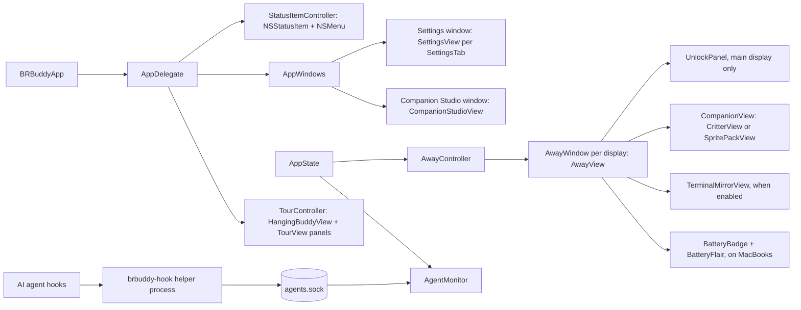

# BRBuddy architecture map

The plumbing guide: **where things live and how they connect**. Read this first, then the flow page for the journey
you're working on (`flows/`). For what's planned and why, see `ROADMAP.md`. The plain-English support guide
(`docs/support-guide.md`) and the visual `map.html` come before the first public release.

> **Depth:** this map names files and types, never functions. Function names change; open the files listed under
> "Code to check" and read the current code before relying on any detail here.

## What the app is
A macOS 14+ menu bar app that keeps the Mac awake while an AI coding agent works, and covers every display with an
away screen ("BRB") that needs Touch ID or the login password to dismiss. BRB starts from the menu, a global
shortcut, or by itself after a few minutes with no input while keep-awake is on, and hands off to the real macOS lock
screen after failed unlocks or a long time away. Everything runs locally; there is no server. Distributed outside the
App Store and not sandboxed.

It also knows what the user's AI agents are doing. Claude Code, Codex, Gemini CLI, Cursor, Antigravity and Grok can
each be hooked up from Settings: BRBuddy adds a hook that runs the `brbuddy-hook` helper, which forwards each event
over a private local socket. While an agent is working or waiting for the user, BRBuddy keeps the Mac awake by itself
and BRB can start on its own; the away screen and menu show what the agent is doing.

The away screen's companion is one of six original built-in critters drawn in code (one per agent's vibe, picked
automatically or by the user) or a community pack in the Codex pet format, and acts out a mood: resting, working,
waiting, finished, greeting or oops.

On a MacBook the away screen shows the battery in its top-right corner, and the companion reacts to it: cheering
when the charger goes in, sweating when low, slow motion in Low Power Mode (on by default; Settings → Away Screen).

Optionally (off by default) the away screen also mirrors a read-only terminal view below the companion: a tmux
pane (with colours), a Terminal/iTerm2/Ghostty window read through Accessibility, or an agent activity feed built
from hook events (no permissions needed).

Walk-away lock (off by default): the user picks their iPhone or Apple Watch; BRBuddy stays connected over Bluetooth
LE, reads its signal strength, and starts BRB (or locks the Mac) when it moves away.

## Scenes / surfaces

| Surface | What it is | Made by |
|---|---|---|
| Menu bar item | Paw icon (filled while keeping awake): keep-awake toggle, BRB now, Settings, Show tour again, Quit. BRBuddy's own `NSStatusItem`, so it knows where the paw is | `StatusItemController`, made by `AppDelegate` |
| First-launch tour | The companion hanging on a string under the menu bar icon (a clear borderless panel), and a four-step tour panel under it; first launch only, or from Show tour again | `TourController` hosting `HangingBuddyView` and `TourView` |
| Companion Studio window | Build a critter from parts, preview and boop it, save it as a pack; opened from Settings → Companion and the tour | `AppWindows` hosting `CompanionStudioView` |
| Settings window | Tabs: General (when BRB starts, when it locks for real, shortcut, launch at login), Agents, Companion, Away Screen (terminal mirror), Walk-away; each tab 540×430 and scrolls; can open at any tab | `AppWindows`: a toolbar `NSTabViewController` hosting `SettingsView` per `SettingsTab` |
| Away windows | One borderless window per display at screen-saver level, on every Space | `AwayController` makes `AwayWindow`s hosting `AwayView` |
| Companion | Animated character on the away screen and in Settings' preview | `CompanionView` (built-in `CritterView` or pack `SpritePackView`) |
| Terminal mirror | Read-only panel on the away screen and in Settings' preview | `TerminalMirrorView` showing `TerminalMirror`'s snapshot |
| Hook helper | Command-line tool agents run on each hook; no UI, prints nothing | `brbuddy-hook/main.swift`, copied by `AgentMonitor` to Application Support |

No Dock icon or main window: `LSUIElement` in `Config/Info.plist`, and `BRBuddyApp` sets the accessory activation
policy for `swift run`.

## Layers

```mermaid
flowchart TD
  Views[BRBuddy views: StatusItemController's menu, SettingsView, AwayView, UnlockPanel, PlaceholderBuddy] --> State[AppState]
  State --> Away[AwayController + AwayWindow]
  State --> Core[BRBuddyCore]
  Away --> Core
  Core --> KA[KeepAwake: IOKit power assertions]
  Core --> Idle[IdleMonitor: CoreGraphics HID idle time]
  Core --> Policy[AwayPolicy + AwaySettings: pure rules, UserDefaults]
  Core --> Lock[ScreenLocker: private login framework]
  Core --> PW[PasswordVerifier: OpenDirectory]
  Away --> LA[LocalAuthentication embedded Touch ID]
  State --> Mon[AgentMonitor]
  Mon --> Core
  Core --> Agents[AgentKind, AgentEvent, AgentTracker: pure]
  Core --> Inst[AgentHookInstaller: agents' JSON/TOML config files]
  Core --> Sock[AgentSocket + AgentEventListener: Unix socket]
  Core --> Scan[AgentProcessScanner: libproc, sysctl]
  State --> Lib[CompanionLibrary]
  Lib --> Core
  Core --> Comp[CompanionMood, CompanionCatalog: pure]
  Core --> Pack[CompanionPack, CompanionPackLibrary: ImageIO, Companions folder]
  State --> Mir[TerminalMirror]
  Mir --> AX[AccessibilityTerminalReader: ApplicationServices AX]
  State --> Prox[ProximityMonitor: CoreBluetooth]
  Prox --> PT[ProximityTracker, ProximitySettings, WalkAwayTest, AppleDeviceInfo, WalkAwayPairing: pure]
  Prox --> PD[PairedDevices: IOBluetooth]
  Mir --> Core
  State --> Bat[BatteryMonitor]
  Bat --> BatCore[BatteryStatus, BatteryWatch, BatteryReaction: IOKit power sources + pure]
  Core --> TText[ANSIParser, TerminalText: pure]
  Core --> Tmux[TmuxReader: tmux list-panes, capture-pane]
  Core --> Feed[AgentActivityLog: pure]
  Helper[brbuddy-hook] --> Sock
```

Three SwiftPM targets. `BRBuddyCore` holds system wrappers and pure logic with no UI, and is what `BRBuddyTests`
tests. `BRBuddy` is the app: SwiftUI views, `AppState`, `AgentMonitor`, `AwayController` and `AwayWindow`.
`brbuddy-hook` is the helper agents run; it uses `BRBuddyCore` for the event and socket code. The only package
dependencies are KeyboardShortcuts (MIT), for the global BRB shortcut and its recorder, and Sparkle (MIT-style), for
automatic updates; both are used only by the app target.

## Who owns what
| Type | File | Created by / lifetime | Isolation / thread | Job |
|---|---|---|---|---|
| `BRBuddyApp` | `BRBuddy/BRBuddyApp.swift` | System, app lifetime | Main actor | Entry point: the SwiftUI app lifecycle, with one scene that never shows (an uninserted menu bar extra); its ⌘, command opens `AppWindows`' Settings |
| `StatusItemController` | `BRBuddy/StatusItemController.swift` | `AppDelegate` (lazily, at launch), app lifetime | Main actor | The paw `NSStatusItem` and its `NSMenu`, rebuilt each time it opens; the icon follows keep-awake through observation; tells the tour where the paw is (`FirstLaunchTour` checks it's on screen and not behind the notch) |
| `AppWindows` | `BRBuddy/AppWindows.swift` | `AppDelegate`, app lifetime | Main actor | Opens the Settings window (an `NSTabViewController` with a toolbar tab per `SettingsTab`, each hosting `SettingsView`) at any tab, and the Companion Studio window |
| `AppDelegate` | `BRBuddy/AppDelegate.swift` | SwiftUI delegate adaptor, app lifetime | Main actor | Owns `AppState`, `UpdateController` and `TourController`; opens the tour on first launch; refuses to quit while BRB is up; debug-only launch hooks |
| `UpdateController` | `BRBuddy/UpdateController.swift` | `AppDelegate`, app lifetime | Main actor | Sparkle updater; exists only when the build's Info.plist has a feed URL and public key (release builds) |
| `AppState` | `BRBuddy/AppState.swift` | `AppDelegate`, app lifetime | `@MainActor`, `@Observable` | Owns `KeepAwake`, `AgentMonitor`, `AwayController`, settings, the 5-second idle check, the global shortcut, launch at login; decides keep-awake (by hand or for an agent) |
| `AgentMonitor` | `BRBuddy/AgentMonitor.swift` | `AppState`, app lifetime | `@MainActor`, `@Observable`; socket on its own queue; process scan detached | Runs the listener, holds `AgentTracker` and `AgentActivityLog`, scans processes and desktop apps every 15 s, sets hooks up or removes them, installs the helper copy |
| `AwayController` | `BRBuddy/AwayController.swift` | `AppState`, app lifetime | `@MainActor`, `@Observable` | Runs BRB: windows, presentation options, focus guard, unlock, failures, escalation, 1-second ticker |
| `AwayWindow` | `BRBuddy/AwayWindow.swift` | `AwayController`, one per display while away | Main thread (AppKit) | Borderless key-capable window; reports input; swallows Command shortcuts |
| `AwayView` | `BRBuddy/AwayView.swift` | `AwayController`, hosted in each `AwayWindow` | Main actor (view) | Companion, tagline, time away, footer per phase |
| `UnlockPanel` | `BRBuddy/UnlockPanel.swift` | `AwayView` on the main display while unlocking | Main actor (view); password check on a detached task | Embedded Touch ID view and password field |
| `CompanionLibrary` | `BRBuddy/CompanionLibrary.swift` | `AppState`, app lifetime | `@MainActor`, `@Observable`; frames cut on a detached task | The user's companion choice; community packs and their frames; import |
| `CompanionView`, `SpritePackView` | `BRBuddy/CompanionView.swift` | `AwayView`, Settings | Main actor (views) | Shows the resolved companion with its battery props; plays boops when clicked; plays a pack's frames at 8 fps |
| `BoopPlayer`, `BoopFlair` | `BRBuddy/BoopView.swift` | Static namespace; `CompanionView` | Main actor | Plays boop sounds; the boop's motion, effects and speech bubble |
| `BatteryMonitor` | `BRBuddy/BatteryMonitor.swift` | `AppState`, app lifetime | `@MainActor`, `@Observable`; 1-second timer while retained | Reads the battery while BRB is up (retained by `AwayController`); holds `BatteryWatch` and the current reaction |
| `BatteryBadge`, `BatteryFlair` | `BRBuddy/BatteryView.swift` | `AwayView`; `CompanionView` | Main actor (views) | The away screen's battery pill (liquid fill, bubbles, glow, sparks); the companion's battery props and speech bubble |
| `TourController` | `BRBuddy/TourController.swift` | `AppDelegate` (lazily), app lifetime | `@MainActor`, `@Observable` | Opens the first-launch tour once, or from the menu; the hanging-companion and tour panels and where they go (asking `StatusItemController` where the paw is); its last step ends the tour and then starts BRB |
| `HangingBuddyView`, `TourView` | `BRBuddy/TourView.swift` | `TourController`'s panels | Main actor (views) | The swaying companion on its string with its speech bubble; the tour's steps (connect agents, pick a companion, extras, try BRB) |
| `CritterView`, `CritterDesign` | `BRBuddy/CritterView.swift` | `CompanionView`, contact sheet | Main actor (views) | Draws and animates the six built-in critters per mood |
| `CompanionStudioView`, `StudioSheetRenderer` | `BRBuddy/CompanionStudio.swift` | `AppWindows` | Main actor; sheets rendered on the main actor, yielding between rows | Companion Studio: edits a `StudioDesign` with a live, boopable preview; renders the pack's two spritesheets from `CritterView`; saves through `StudioPackWriter` and picks it |
| `CompanionContactSheet` | `BRBuddy/CompanionContactSheet.swift` | `AppDelegate` (debug only) | Main actor | Renders every built-in in every mood to a PNG, and the app icon options |
| `AppIconArt` | `BRBuddy/CompanionContactSheet.swift` | `CompanionContactSheet` (debug only) | Main actor | The app icon artwork, drawn with `CritterView`; option 2 ("BRB bubble") is `Config/AppIcon.icns` |
| `PromoFilm` | `BRBuddy/PromoFilm.swift` | `AppDelegate` (debug only) | Main actor | Draws the promo film frame by frame with `CritterView`, `BoopFlair` and `AppIconArt` |
| `TerminalMirror` | `BRBuddy/TerminalMirror.swift` | `AppState`, app lifetime | `@MainActor`, `@Observable`; capture on a detached task | Picks a source per `TerminalMirrorMode`, refreshes every second while retained (BRB up or Settings open) |
| `TerminalMirrorView` | `BRBuddy/TerminalMirrorView.swift` | `AwayView`, Settings | Main actor (view) | Draws styled lines, latest that fit; no input path |
| `ProximityMonitor` | `BRBuddy/ProximityMonitor.swift` | `AppState`, app lifetime; Bluetooth manager created only when walk-away is on or the picker is open | `@MainActor`, `@Observable`; CoreBluetooth on the main queue | Lists nearby iPhones and Watches (filters accessories by Continuity type, briefly connects to read each model, hides Macs/iPads, marks the closest); connects to the chosen one, reads RSSI every 2 s, reconnects; tells `AppState` when it leaves |
| `PairedDevices` | `BRBuddy/PairedDevices.swift` | Static namespace | Main actor in practice | Names of phones paired in System Settings → Bluetooth (IOBluetooth); the Bluetooth settings link |
| `AccessibilityTerminalReader` | `BRBuddy/AccessibilityTerminalReader.swift` | Static namespace | Running apps on main; AX reads off main | Text of a Terminal/iTerm2/Ghostty window; Accessibility permission prompt |
| `TerminalFocuser` | `BRBuddy/TerminalFocuser.swift` | Static namespace | Main actor; `osascript` on a detached task | Finds the running app hosting a session; selects its Terminal/iTerm2 tab by tty, else activates the app and raises the window for its folder (Accessibility) |
| `SettingsTab`, `SettingsView`, `LaunchAtLoginToggle` | `BRBuddy/SettingsView.swift` | `AppWindows`, one view per tab; the toggle also in `TourView` | Main actor (views) | Edits `AwaySettings` through `AppState`; the launch-at-login switch (shows when macOS is waiting for the user's OK in Login Items) |
| `KeepAwake` | `BRBuddyCore/KeepAwake.swift` | `AppState`, app lifetime | Used from the main actor | Holds at most one IOKit power assertion; released on `deinit` |
| `AwaySettings` | `BRBuddyCore/AwaySettings.swift` | Value, held by `AppState` and copied into `AwayController` at start | Value type | Preferences; loads with defaults and clamping, saves to UserDefaults |
| `AwayPolicy` | `BRBuddyCore/AwayPolicy.swift` | Static namespace | Pure | When to auto-start; when to escalate |
| `IdleMonitor` | `BRBuddyCore/IdleMonitor.swift` | Static namespace | Any thread | Seconds since last HID input |
| `ScreenLocker` | `BRBuddyCore/ScreenLocker.swift` | Static namespace | Main actor in practice | Real lock screen via private login framework; display-sleep fallback |
| `PasswordVerifier` | `BRBuddyCore/PasswordVerifier.swift` | Static namespace | Off the main thread (slow, throttled) | Checks the login password through OpenDirectory |
| `AgentKind` | `BRBuddyCore/AgentKind.swift` | Enum | Value type | The six agents: names, hook events, event → `AgentActivity` |
| `AgentEvent` | `BRBuddyCore/AgentEvent.swift` | Value, made by the helper, decoded by the listener | Value type | One hook firing; reads each agent's stdin payload (session, folder, tool detail; never the prompt); JSON-line wire format |
| `AgentTracker` | `BRBuddyCore/AgentTracker.swift` | Value, held by `AgentMonitor` | Value type | Session states, timeouts, overall `Summary` |
| `AgentHookInstaller` | `BRBuddyCore/AgentHookInstaller.swift` | Value, held by `AgentMonitor` | Main actor in practice | Adds/removes our hooks in each agent's config; backups; Codex feature flag |
| `AgentSocket`, `AgentEventListener` | `BRBuddyCore/AgentSocket.swift` | Static namespace; listener owned by `AgentMonitor` | Listener reads on a private serial queue | Socket path, sending (helper), listening (app) |
| `AgentProcessScanner` | `BRBuddyCore/AgentProcessScanner.swift` | Static namespace | Any thread (run detached) | Running agent CLIs by process name or Node script path; desktop app bundle IDs |
| `TerminalLocation` | `BRBuddyCore/TerminalLocation.swift` | Value, made by the helper, carried on `AgentEvent` and `AgentTracker.Session` | Value type | App bundles among the hook's ancestors and its controlling tty, read from the kernel |
| `CompanionMood` | `BRBuddyCore/CompanionMood.swift` | Enum | Value type | Which mood to show, and its Codex spritesheet row |
| `StudioDesign`, `StudioColor`, `StudioPackWriter` | `BRBuddyCore/StudioDesign.swift` | Values / static namespace | Pure, plus file writes | A Studio companion's parts, colours (`#RRGGBB`), signature and line; random designs; folder names; writes `design.json`, `pet.json` and the sheets |
| `Boop`, `BoopEvent`, `BoopPicker`, `BoopSignature`, `BoopSound` | `BRBuddyCore/Boop.swift` | Values, `BoopPicker` held by `CompanionView` | Pure | The six click reactions (five shared, one signature); which comes next; each companion's signature; their synthesised WAV sounds |
| `FirstLaunchTour` | `BRBuddyCore/FirstLaunchTour.swift` | Static namespace | Any | The tour's steps and order, whether it has been seen, where its panels go under the menu bar item (or the middle of the screen when the item is hidden) |
| `BatteryStatus`, `BatteryReaction`, `BatteryWatch` | `BRBuddyCore/Battery.swift` | Values, held by `BatteryMonitor` | Value types; `read` on the main actor | The internal battery from IOKit power sources; which reaction to show; noticing plug and unplug |
| `CompanionCatalog`, `CompanionShuffle` | `BRBuddyCore/CompanionCatalog.swift` | Static namespace; value held by `CompanionLibrary` | Pure | Built-in list and agent matches; stored `Choice`; resolving a choice to a companion; Shuffle's running order |
| `CompanionPack`, `CompanionPackLibrary` | `BRBuddyCore/CompanionPack.swift` | Values / static namespace | Load anywhere; cut frames off the main thread | Validates a Codex pet folder, cuts frames per mood (and from an optional still sheet, shown on battery), scans and imports packs |
| `ANSIParser`, `TerminalColor`, `TerminalStyle`, `TerminalRun` | `BRBuddyCore/TerminalText.swift` | Static namespace / values | Pure | Colour-coded text → styled lines; drops every non-colour escape; xterm palette |
| `TmuxReader` | `BRBuddyCore/TmuxReader.swift` | Static namespace | Off the main thread (runs tmux, 2 s limit) | Finds tmux, lists panes, picks the agent's pane, captures it read-only |
| `AgentActivityLog` | `BRBuddyCore/AgentActivityLog.swift` | Value, held by `AgentMonitor` | Value type | Rolling feed (80 entries) of agent events as styled lines |
| `TerminalMirrorMode` | `BRBuddyCore/TerminalMirrorMode.swift` | Enum | Value type | Off / automatic / tmux / terminal window / activity feed; stored in UserDefaults |
| `AppleDeviceInfo`, `WalkAwayPairing` | `BRBuddyCore/AppleDeviceInfo.swift` | Static namespaces | Pure | Whether a device is a paired phone with its own name (walk-away needs it);  Continuity message types in Apple advertisements; model number → iPhone / Watch / iPad / Mac |
| `ProximityTracker`, `ProximitySettings`, `WalkAwayTest` | `BRBuddyCore/ProximityTracker.swift` | Values, held by `ProximityMonitor` | Value types | Median-smoothed RSSI → near / away with delay and hysteresis; walk-away preferences; the Settings dry run's three steps |

`AppState` is passed to views by initializer; `AwayController` is reached through `AppState`. There are no
singletons. `AwayController` notifies `AppState` that BRB ended through a callback so keep-awake can change mode.

## Navigation
Menu: keep-awake toggle (plus "Kept awake while your agent works" when an agent is the reason), BRB now (shows the global shortcut), a hint line when auto-start is armed, the agents list (up to six sessions with state and project, or "Set up agents…"; clicking one jumps to the window, and in Terminal/iTerm2 the tab, it runs in), Settings…, Show tour again, Quit. Settings has five tabs (General, Agents, Companion, Away Screen, Walk-away); Agents has a row per agent.
Away screen phases (`AwayController.Phase`): resting → (any key, click, scroll or mouse move) unlocking → back to
resting after 30 seconds without input; any phase → locking for real when `AwayPolicy` says so.

## Data
`AwaySettings` in UserDefaults under `away.*` keys: auto-start on/off, idle minutes (1–120, default 3), failed tries
before real lock (1–10, default 3), minutes before real lock (0 = never, default 60). The global shortcut is stored
by KeyboardShortcuts; `agents.keepAwake` holds "keep awake while an agent works" (default on); `companion.choice` holds
the companion (`auto`, `shuffle`, `builtin:<id>` or `pack:<folder>`), and `companion.shuffle.*` Shuffle's current pick
and what's left this round; `mirror.mode` holds the terminal mirror mode (default
`off`); `away.showBattery` holds the battery badge (default on); `companion.boopSounds` holds boop sounds (default on); `proximity.*` holds walk-away (enabled, device ID and name, range, action); `tour.seen` records that the first-launch tour was finished, skipped or closed. Launch at login is
held by macOS (`SMAppService`). Passwords are never stored or logged.

Agent files: `~/Library/Application Support/BRBuddy/agents.sock` (the socket, 0600, recreated at launch) and
`bin/brbuddy-hook` (the helper copy) in the same folder. Setting up an agent edits that agent's own file:
`~/.claude/settings.json`, `~/.codex/hooks.json` (and `[features] hooks = true` in `~/.codex/config.toml`),
`~/.gemini/settings.json`, `~/.cursor/hooks.json`, `~/.gemini/config/hooks.json` (Antigravity, under a `brbuddy`
group) or `~/.grok/hooks/brbuddy.json` (our own file). The first change saves `<file>.brbuddy-backup`. Agent
sessions are kept in memory only.

Companion packs live in `~/Library/Application Support/BRBuddy/Companions/<folder>/` (`pet.json` + spritesheet,
Codex pet format v1 or v2, at most 20 MB). "Add companion pack…" validates a folder and copies it there. Companion
Studio saves there too, adding `design.json`; a pack with one is drawn live by `CritterView`.

## Concurrency
Swift 6 language mode. App types are main-actor; timers hop back with `MainActor.assumeIsolated`. The password check
runs on a detached task and returns to the main actor. Touch ID results arrive on a LocalAuthentication queue and
are ignored if the `LAContext` they belong to has been replaced. Agent events arrive on `AgentEventListener`'s
serial queue and hop to the main actor in `AgentMonitor`; the process scan runs detached at utility priority.

## House rules (don't break these)
| Rule | Where it's enforced or explained |
|---|---|
| Never ship company logos or mascots (Claude crab, OpenAI knot, etc.) | `CONTRIBUTING.md` |
| Copy code only from permissive licenses, and record its notice | `THIRD_PARTY_NOTICES.md` |
| Keep-awake must always be releasable: one assertion at a time, released on quit | `KeepAwake`, `KeepAwakeTests` |
| Logic and system wrappers go in `BRBuddyCore` so they can be tested | This map; the target split is in the package manifest at the repo root |
| Unlock UI stays inside the away window (no system dialogs: they'd open underneath) | `UnlockPanel`, `PasswordVerifier` |
| Release builds must carry the Sparkle public key and a signed appcast; local builds have no updater | `UpdateController`, `Tools/release.sh` |
| Never call the real lock or a wrong password from tests | `SystemHookTests` in the test target |
| BRB can't be quit while it's up | `AppDelegate`, `AwayWindow` |
| The hook helper never prints, never blocks, always exits 0 | `brbuddy-hook/main.swift`, `AgentSocketTests` |
| Only touch our own hook entries; back up first; never rewrite invalid JSON | `AgentHookInstaller`, `AgentHookInstallerTests` |
| Agent config files change only when the user presses Set up or Remove | `AgentMonitor`, `SettingsView` |
| Built-in companions are original and code-drawn; never bundle third-party pet art | `CritterView`, `CONTRIBUTING.md` |
| A pack's spritesheet must stay inside its own folder | `CompanionPack`, `CompanionPackTests` |
| The mirror is display-only: never send keys, attach a tmux client or forward input | `TmuxReader`, `TerminalMirrorView` |
| The mirror is off by default and Settings warns that anyone at the Mac can read it | `TerminalMirrorMode`, `SettingsView` |
| Hook events carry tool details, never the user's prompt text | `AgentEvent`, `ActivityFeedTests` |
| Touch Bluetooth only when walk-away is on or the picker is open (no surprise permission prompt) | `ProximityMonitor` |
| Walk-away only uses an iPhone paired with this Mac: unpaired iPhones change address every ~15 min and get lost or confused with strangers' phones | `WalkAwayPairing`, `ProximityMonitor`, `WalkAwayPairingTests` |
| The Bluetooth usage text must stay in the bundle's Info.plist, or macOS kills the app on first use | `Config/Info.plist`, `ProximityMonitor` |
| Signed builds keep the Apple-events entitlement and usage text, or jumping to a Terminal/iTerm2 tab silently fails | `Config/BRBuddy.entitlements`, `Config/Info.plist`, `Tools/build-app.sh` |

## Debug only
Debug builds read these environment variables, all compiled out of release builds:
- In `AppDelegate`: `BRBUDDY_START_AWAY=<seconds>` opens BRB that many seconds after launch, and
  `BRBUDDY_SNAPSHOT_DIR` then saves PNGs of the main away window resting and unlocking (`AwayController`'s debug
  snapshot code).
- Rendered by `CompanionContactSheet`: `BRBUDDY_COMPANION_SHEET=<file.png>` (every built-in in every mood),
  `BRBUDDY_MOUTH_SHEET`, `BRBUDDY_BOOP_SHEET`, `BRBUDDY_BATTERY_SHEET`, `BRBUDDY_STUDIO_SNAPSHOT=<dir>`,
  `BRBUDDY_ICON_OPTIONS=<dir>` (the app icon candidates, `AppIconArt`) and `BRBUDDY_SITE_ART=<dir>` (the
  website's companion images; see `site/README.md`).
- `BRBUDDY_PROMO=<dir>` (`PromoFilm`): the 30-second promo film's frames (wide and tall) and boop sounds, then quits;
  `BRBUDDY_PROMO_ONLY=<seconds,...>` renders just those moments. `Tools/promo/make-promo.sh` turns them into MP4s.
- `BRBUDDY_MENU_DUMP=1` prints the menu as it would open (`StatusItemController`); `BRBUDDY_OPEN_SETTINGS=<0-4>`
  opens Settings at that tab (`AppWindows`).
- `BRBUDDY_TOUR=1` shows the first-launch tour even if it was seen, and `BRBUDDY_TOUR_SNAPSHOTS=<dir>` saves PNGs of
  the hanging companion and every tour step (`TourController`).
- `BRBUDDY_FAKE_BATTERY` (`BatteryMonitor`) and `BRBUDDY_SOCKET` (`AgentSocket`, used by the tests).

## Journeys (flow pages)
| Page | Covers |
|---|---|
| `flows/keep-awake.md` | Turning keep-awake on and off; which power mode is held when |
| `flows/brb-away.md` | Starting BRB, unlocking, and handing off to the real lock screen |
| `flows/agents.md` | Setting up an agent's hooks and how its events reach the app |
| `flows/companions.md` | Choosing a companion, adding a pack, and how moods are picked |
| `flows/terminal-mirror.md` | Turning on the terminal mirror and where its text comes from |
| `flows/walk-away.md` | Picking a phone or watch and what happens when it leaves |
| `flows/battery.md` | The battery badge on the away screen and how the companion reacts |
| `flows/first-launch-tour.md` | The companion hanging under the menu bar on first launch, and the tour it opens |

## File index
Every source file in `Sources/`. The docs test fails if a file is missing here or a listed one is gone.

**BRBuddy (app)**
- `BRBuddy/BRBuddyApp.swift`: entry point, the app lifecycle and ⌘, command, accessory activation policy.
- `BRBuddy/StatusItemController.swift`: the paw in the menu bar and its menu.
- `BRBuddy/AppWindows.swift`: opens the Settings and Companion Studio windows.
- `BRBuddy/AppDelegate.swift`: owns app state and updates, blocks quitting during BRB, debug launch hooks.
- `BRBuddy/UpdateController.swift`: Sparkle automatic updates and "Check for Updates…".
- `BRBuddy/AppState.swift`: app state; keep-awake mode, idle check, global shortcut, launch at login.
- `BRBuddy/AwayController.swift`: runs BRB end to end.
- `BRBuddy/AwayWindow.swift`: the full-screen window used on each display.
- `BRBuddy/AwayView.swift`: what the away windows show.
- `BRBuddy/UnlockPanel.swift`: embedded Touch ID and password field.
- `BRBuddy/CompanionLibrary.swift`: companion choice, community packs and their frames.
- `BRBuddy/BoopView.swift`: boop sounds, motion and effects.
- `BRBuddy/BatteryMonitor.swift`: reads the battery while BRB is up; notices plug and unplug.
- `BRBuddy/BatteryView.swift`: the away screen's battery badge and the companion's battery props.
- `BRBuddy/TourController.swift`: runs the first-launch tour and its two panels.
- `BRBuddy/TourView.swift`: the hanging companion and the tour's steps.
- `BRBuddy/CompanionStudio.swift`: Companion Studio window and its spritesheet renderer.
- `BRBuddy/CompanionView.swift`: shows the chosen companion; sprite pack player.
- `BRBuddy/CritterView.swift`: the six built-in critters and their shapes.
- `BRBuddy/CompanionContactSheet.swift`: debug-only render of every critter and mood, and the app icon artwork.
- `BRBuddy/PromoFilm.swift`: debug-only promo film renderer (frames and boop sounds for `Tools/promo/make-promo.sh`).
- `BRBuddy/TerminalMirror.swift`: picks and refreshes the terminal mirror's source.
- `BRBuddy/TerminalMirrorView.swift`: draws the read-only terminal panel.
- `BRBuddy/AccessibilityTerminalReader.swift`: reads terminal window text via Accessibility.
- `BRBuddy/ProximityMonitor.swift`: Bluetooth device picker and walk-away watching.
- `BRBuddy/PairedDevices.swift`: phones paired with this Mac, from macOS's paired-device list.
- `BRBuddy/TerminalFocuser.swift`: jumps from a menu row to the agent's terminal tab or window.
- `BRBuddy/SettingsView.swift`: the Settings window and its five tabs.
- `BRBuddy/AgentMonitor.swift`: agent events, sessions, process scan and hook setup for the app.

**BRBuddyCore**
- `BRBuddyCore/KeepAwake.swift`: IOKit power assertion wrapper (system only, or system and display).
- `BRBuddyCore/AwaySettings.swift`: BRB preferences and their UserDefaults storage.
- `BRBuddyCore/AwayPolicy.swift`: auto-start and escalation rules.
- `BRBuddyCore/IdleMonitor.swift`: time since last keyboard or mouse input.
- `BRBuddyCore/ScreenLocker.swift`: shows the real macOS lock screen.
- `BRBuddyCore/PasswordVerifier.swift`: checks the login password.
- `BRBuddyCore/AgentKind.swift`: supported agents and what their hook events mean.
- `BRBuddyCore/AgentEvent.swift`: one hook event, payload parsing and wire format.
- `BRBuddyCore/AgentTracker.swift`: agent session states and summary.
- `BRBuddyCore/AgentHookInstaller.swift`: adds and removes hooks in agents' config files.
- `BRBuddyCore/AgentSocket.swift`: the local socket, sending and listening.
- `BRBuddyCore/AgentProcessScanner.swift`: finds running agents and desktop apps.
- `BRBuddyCore/TerminalLocation.swift`: which app and terminal tab a hook ran from.
- `BRBuddyCore/Boop.swift`: click reactions, the picker and their synthesised sounds.
- `BRBuddyCore/Battery.swift`: battery status from IOKit, battery reactions, plug/unplug watch.
- `BRBuddyCore/FirstLaunchTour.swift`: the tour's steps, seen flag and panel placement.
- `BRBuddyCore/StudioDesign.swift`: Companion Studio designs and writing them as packs.
- `BRBuddyCore/CompanionMood.swift`: companion moods and their spritesheet rows.
- `BRBuddyCore/CompanionCatalog.swift`: built-in companions and resolving the user's choice.
- `BRBuddyCore/CompanionPack.swift`: loading, checking and importing Codex-format packs.
- `BRBuddyCore/TerminalText.swift`: colour-code parser and styled terminal text.
- `BRBuddyCore/TmuxReader.swift`: read-only tmux pane listing and capture.
- `BRBuddyCore/AgentActivityLog.swift`: the agent activity feed.
- `BRBuddyCore/TerminalMirrorMode.swift`: the mirror setting.
- `BRBuddyCore/ProximityTracker.swift`: near/away decisions from signal strength; walk-away settings; the walk-away test.
- `BRBuddyCore/AppleDeviceInfo.swift`: tells phones and watches from other Apple devices; pairing status for walk-away.

**brbuddy-hook (helper)**
- `brbuddy-hook/main.swift`: run by agent hooks; forwards one event and exits.

## Building and releasing
- `Tools/build-app.sh` makes `build/BRBuddy.app`: the app, the hook helper in `Contents/Helpers`, Sparkle in
  `Contents/Frameworks`, licences in `Resources`; version from the latest `v*` tag, build number from the commit
  count; signs inside out (ad hoc by default, Developer ID with hardened runtime when `SIGN_IDENTITY` is set); adds
  the update feed only when `SPARKLE_PUBLIC_KEY` is set.
- `Tools/release.sh <version>` makes the universal, notarized DMG, signed `appcast.xml` and Homebrew cask in
  `build/release/`. `.github/workflows/release.yml` runs it on a `v*` tag; `tests.yml` runs the tests on pull
  requests and pushes to main. One-time setup and the checklist: `docs/releasing.md`.
- Update feed: `https://github.com/dhaataalimited-hub/brbuddy/releases/latest/download/appcast.xml` (needs the
  repository public). Never publish an unsigned appcast: Sparkle ignores it and users silently stop updating
  (`Tools/release.sh` refuses).
- `Tools/promo/make-promo.sh` makes the promo videos in `build/promo/` from the debug app's `PromoFilm` frames and
  the soundtrack `Tools/promo/music.py` synthesises (needs ffmpeg and numpy).
- `Tools/gallery/gallery.py` looks after the companion gallery on the website (`site/gallery/`): `add` checks a
  reviewed pack against the pack spec and publishes its preview sheet and zip, `remove` takes one down, `prompt`
  copies the AI prompt from `docs/making-a-companion.md` for the page. Submissions come in through the
  **Share a companion** issue form (`.github/ISSUE_TEMPLATE/share-a-companion.yml`). Not part of the app.
- `Tools/gallery/originals/draw.py` draws BRBuddy's own gallery companions (Pip, Glorp, Nova, Dot, Scoot, Momo) in
  Pillow, straight to the pack spec, and checks the top-right corner and cell edges stay empty.

## Keeping this map current
- **When you add, move, rename or rewire a type:** update this file (file index, owners table) and the flow page it
  belongs to. `ArchitectureDocsTests` fails on a file missing from the index, a file name that no longer exists, or a
  type under "Code to check" that's no longer declared.
- **Then regenerate `map.html`** from these pages and republish the artifact (once it exists, before release).
- Keep to types and files. If you find yourself writing a function name, write what it does instead.
- HTML artifact (private to the owner): https://claude.ai/artifact/WDGNXHsAuf5CJ7zDpKNKar. Republish `map.html` to
  the same URL after changes.
