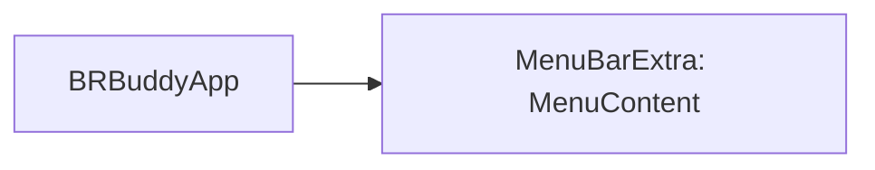
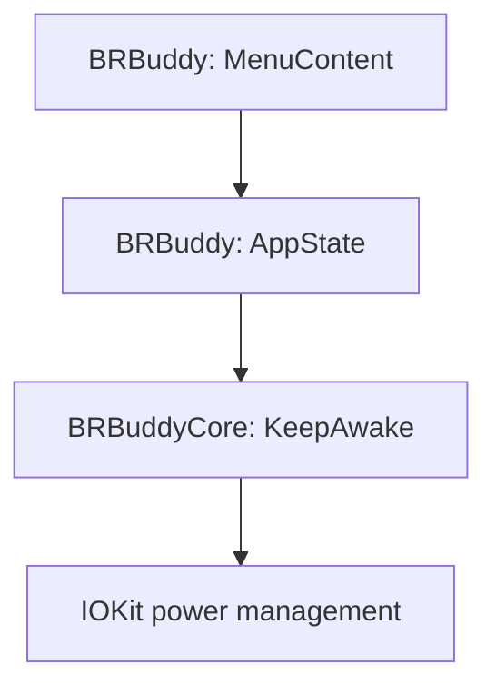

# BRBuddy architecture map

The plumbing guide: **where things live and how they connect**. Read this first, then the flow page for the journey
you're working on (`flows/`). For what's planned and why, see `ROADMAP.md`. The plain-English support guide
(`docs/support-guide.md`) and the visual `map.html` come before the first public release.

> **Depth:** this map names files and types, never functions. Function names change; open the files listed under
> "Code to check" and read the current code before relying on any detail here.

## What the app is
A macOS 14+ menu bar app that keeps the Mac awake while an AI coding agent works, and (from Phase 1) covers the
screen with an away display that needs Touch ID or a password to dismiss. Everything runs locally; there is no server.
Distributed outside the App Store and not sandboxed.

## Scenes / surfaces

| Surface | What it is | Made by |
|---|---|---|
| Menu bar item | Paw icon (filled while keeping awake) with a small menu | `BRBuddyApp` showing `MenuContent` |

No Dock icon or main window: `LSUIElement` in `Config/Info.plist`, and `BRBuddyApp` sets the accessory activation
policy for `swift run`. Planned: one away window per display (Phase 1).

## Layers

Two SwiftPM targets. `BRBuddyCore` holds system wrappers and pure logic with no UI, and is what `BRBuddyTests`
tests. `BRBuddy` is the app: SwiftUI views and the observable `AppState`.

## Who owns what
| Type | File | Created by / lifetime | Isolation / thread | Job |
|---|---|---|---|---|
| `BRBuddyApp` | `BRBuddy/BRBuddyApp.swift` | System, app lifetime | Main actor | Entry point; owns `AppState` as `@State`; draws the menu bar item |
| `AppState` | `BRBuddy/AppState.swift` | `BRBuddyApp`, app lifetime | `@MainActor`, `@Observable` | What BRBuddy is doing right now; owns `KeepAwake` |
| `MenuContent` | `BRBuddy/MenuContent.swift` | `BRBuddyApp`'s menu scene | Main actor (view) | Menu items; reads and changes `AppState` |
| `KeepAwake` | `BRBuddyCore/KeepAwake.swift` | `AppState`, app lifetime | Not thread-safe; used from the main actor | Holds at most one IOKit power assertion; released on `deinit` |

`AppState` is passed to views by initializer. There are no singletons.

## Navigation
One menu. Items: keep-awake toggle, BRB (disabled placeholder), Quit.

## Data
Nothing is persisted yet. Settings (idle timeout, chosen companion, hotkey) arrive with Phase 1.

## Concurrency
Swift 6 language mode. App types are main-actor. `KeepAwake` calls IOKit synchronously; the calls are quick.

## House rules (don't break these)
| Rule | Where it's enforced or explained |
|---|---|
| Never ship company logos or mascots (Claude crab, OpenAI knot, etc.) | `CONTRIBUTING.md` |
| Copy code only from permissive licenses, and record its notice | `THIRD_PARTY_NOTICES.md` |
| Keep-awake must always be releasable: one assertion at a time, released on quit | `KeepAwake`, `KeepAwakeTests` |
| Logic and system wrappers go in `BRBuddyCore` so they can be tested | This map; the target split is in the package manifest at the repo root |

## Debug only
None yet.

## Journeys (flow pages)
| Page | Covers |
|---|---|
| `flows/keep-awake.md` | Turning keep-awake on and off from the menu bar |

## File index
Every source file in `Sources/`. The docs test fails if a file is missing here or a listed one is gone.

**BRBuddy (app)**
- `BRBuddy/BRBuddyApp.swift`: entry point, menu bar scene, accessory activation policy.
- `BRBuddy/AppState.swift`: observable app state; owns keep-awake.
- `BRBuddy/MenuContent.swift`: the menu's items.

**BRBuddyCore**
- `BRBuddyCore/KeepAwake.swift`: IOKit power assertion wrapper (system only, or system and display).

## Keeping this map current
- **When you add, move, rename or rewire a type:** update this file (file index, owners table) and the flow page it
  belongs to. `ArchitectureDocsTests` fails on a file missing from the index, a file name that no longer exists, or a
  type under "Code to check" that's no longer declared.
- **Then regenerate `map.html`** from these pages and republish the artifact (once it exists, before release).
- Keep to types and files. If you find yourself writing a function name, write what it does instead.
- HTML artifact: not published yet.
