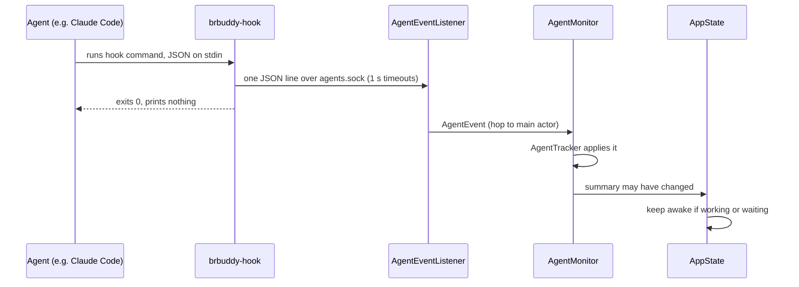

# Agents: setup and status

## What the user does
Opens Settings. The Agents section lists Claude Code, Codex, Gemini CLI, Cursor, Antigravity and Grok, each marked
"Hooked up", "Not set up" or "Not found on this Mac", plus "running now" when its process is up. They press
**Set up** for the ones they use. From then on, while an agent works or waits for them, the menu lists it ("⚙︎
Claude Code · brbuddy — working"; clicking the row jumps to that agent's terminal tab or window), the Mac stays awake by itself, BRB can start on its own, and the away screen says
what the agent is doing. **Remove** takes the hook out again. Desktop apps (Claude, ChatGPT/Codex, Cursor) are only
noted as open: they have no hooks.

## Types involved, in order
Setup: `SettingsView` (`AgentRow`) → `AgentMonitor` → `AgentHookInstaller` → the agent's config file.
Events: agent hook → `brbuddy-hook/main.swift` (`AgentEvent` from stdin, `AgentSocket` send) → `AgentEventListener`
→ `AgentMonitor` (`AgentTracker`) → `AppState` (keep-awake mode) and the views (`MenuContent`, `AwayView`).
Jump: `brbuddy-hook` adds a `TerminalLocation` (ancestor apps, tty) to each event → `AgentTracker.Session` →
`MenuContent` row → `TerminalFocuser` (AppleScript tab select for Terminal/iTerm2, else activate + Accessibility raise).
Detection: `AgentMonitor` every 15 s → `AgentProcessScanner` (detached) and running desktop apps.

## States and edge cases
- Event meaning per agent is in `AgentKind`: working (prompt submitted, tool use), waiting (Notification, Codex
  PermissionRequest), finished (Stop, Gemini AfterAgent, Cursor stop), started, ended (removes the session).
- Payload keys differ per agent; `AgentEvent` tries `session_id`, `sessionId`, `conversation_id`,
  `conversationId` and `cwd`, `workspace_roots`, `workspaceRoot`, `workspacePaths`. No ID → one session per agent.
- Timeouts (`AgentTracker`): working 30 min without events, waiting 4 h, finished/started 15 min. Pruned every 15 s.
- The listener trusts nothing a client sends: each event is stamped with the time it arrived (a future date can't keep
  a session "working" forever), every string is capped (`AgentEvent`), and reading one client stops after 1 s or
  64 KB. The socket path override `BRBUDDY_SOCKET` only exists in debug builds (tests).
- App not running: the helper's connect fails and it exits 0 at once. Agent never waits more than ~2 s (1 s stdin
  read limit, 1 s socket timeout).
- Hook events registered per agent leave out blocking gates where an agent treats a failing hook as "deny" (Grok's
  PreToolUse). Our helper always exits 0, so it can't deny anything anyway.
- Setup refuses a config file that isn't valid JSON and says so in the row. First change backs the file up as
  `<file>.brbuddy-backup`. Files are rewritten with sorted keys and pretty printing. A config that's a symlink (a
  dotfiles repo) is written through the link, which stays; files keep their permissions, and new ones are 0600.
- Codex also gets `[features] hooks = true` in `~/.codex/config.toml` (only that line is touched; a `hooks` key in any
  other table is left alone).
- "Set up" is disabled when the agent's settings folder doesn't exist and it isn't running.
- The helper is copied from the app bundle (`Contents/Helpers`) to Application Support on launch whenever it
  differs, so hooks keep working if the app moves.

- Jumping to a session: the helper walks its own process ancestry (sysctl `KERN_PROC_PID`, `proc_pidpath`) and
  lists every `.app/Contents/MacOS` bundle on the way, nearest first, plus the first controlling tty. The app picks
  the first that's a running regular app, so wrappers (Xcode's Python.app, Claude Code's bundled `claude.app`,
  editor helper apps) are skipped. A row with no such app (old events, tmux server sessions, SSH) is plain text.
- Terminal and iTerm2 select the tab whose `tty` matches (macOS asks once to let BRBuddy control them). Ghostty,
  Cursor, VS Code and others are activated, and with Accessibility allowed the window whose document is the
  session folder, else whose title names it, is raised.

## Gotchas
- Agents change hook formats (Codex renamed its feature flag; Google replaced Gemini CLI with Antigravity). Formats
  follow AgentPet as of 2026-11-20; re-check when an agent updates.
- Hooks fire only for sessions started after setup; running sessions show up from their next event (or restart).
- Jump-to-terminal was checked on 2026-11-21 with a real Terminal.app tab (helper reported Terminal.app and its tty;
  the script selected that tab). iTerm2 and Ghostty weren't installed, so their paths are untested.
- Only Claude Code and Codex were present on the owner's Mac on 2026-11-20. End-to-end testing used fake events sent
  through the real helper; no real agent config was edited.

## Code to check
Function names change: read the current code in these files before relying on any detail above.
- `AgentMonitor.swift`, `SettingsView.swift`, `MenuContent.swift`, `TerminalFocuser.swift`, `TerminalLocation.swift`, `AgentKind.swift`, `AgentEvent.swift`,
  `AgentTracker.swift`, `AgentHookInstaller.swift`, `AgentSocket.swift`, `AgentProcessScanner.swift`,
  `brbuddy-hook/main.swift`
- Types: `AgentMonitor`, `AgentKind`, `AgentActivity`, `AgentEvent`, `AgentTracker`, `AgentHookInstaller`,
  `AgentSocket`, `AgentEventListener`, `AgentProcessScanner`, `TerminalLocation`, `TerminalFocuser`, `AppState`
- Tests: `AgentEventTests`, `AgentTrackerTests`, `AgentHookInstallerTests`, `AgentSocketTests`, `TerminalLocationTests`
