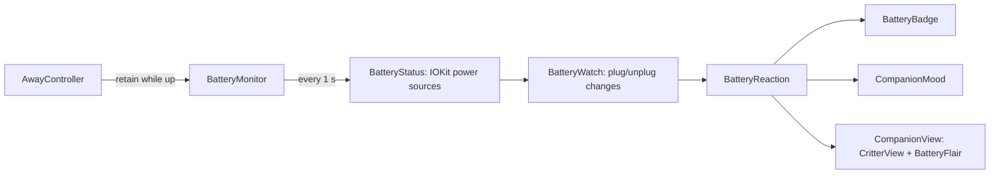

# Battery on the away screen

## What the user does
Nothing: on a MacBook the away screen shows a battery badge in the top-right corner of every display, and the
companion reacts to it. Plugging in the charger makes the companion cheer ("yum!", orbiting bolts, a glow); pulling
it out makes it startled ("hey!"). A low battery makes it droop and sweat ("snack?"), a critical one wobble and plead
("plug me in!"); Low Power Mode plays it in slow motion with a tortoise. It can be turned off in Settings → Away
Screen → Battery. Desktop Macs show nothing.

## Types involved, in order
`AwayController` starts BRB → retains `BatteryMonitor` (when `AwaySettings` says to show the battery) → every second
it reads `BatteryStatus` from IOKit power sources into `BatteryWatch`, which notices plug and unplug →
`BatteryReaction` → `AwayView` shows `BatteryBadge` and passes the reaction to `CompanionMood` and `CompanionView`
→ `CritterView` changes how it moves and `BatteryFlair` draws the props and speech bubble over either kind of
companion. BRB ending releases the monitor and its timer stops.

## States and edge cases
- Reaction order: a plug or unplug in the last 6 seconds, then critical (≤10% on battery), low (≤20%), Low Power
  Mode, full (plugged in at 100%, or holding at 95%+), charging, nothing.
- The first reading after BRB starts never counts as a plug or unplug.
- Only the two flourishes change the companion's mood (finished for plugged in, oops for unplugged), and only when
  nobody is unlocking and no unlock just failed. Other reactions keep the agent's mood and add props.
- The battery's speech bubble gives way when the agent is waiting for the user or someone is unlocking.
- "Time left" comes from macOS; while it's still calculating the badge leaves the time off.
- Community packs get the props and bubble but not the slow-motion or droop, which are drawn by `CritterView`.
- The setting is read when BRB starts, like the others.

## Gotchas
- Reads only while BRB is up: no timer or IOKit calls otherwise.
- Debug builds: `BRBUDDY_FAKE_BATTERY` steps through fake readings and `BRBUDDY_BATTERY_SHEET` renders every reaction
  to a PNG via `CompanionContactSheet`.

## Code to check
Function names change: read the current code in these files before relying on any detail above.
- `Battery.swift`, `BatteryMonitor.swift`, `BatteryView.swift`, `CritterView.swift`, `CompanionView.swift`,
  `AwayView.swift`, `AwayController.swift`, `CompanionMood.swift`, `AwaySettings.swift`, `SettingsView.swift`
- Types: `BatteryStatus`, `BatteryReaction`, `BatteryWatch`, `BatteryMonitor`, `BatteryBadge`, `BatteryFlair`,
  `CritterView`, `CompanionView`, `CompanionMood`, `AwaySettings`
- Tests: `BatteryTests`, `CompanionMoodTests`
