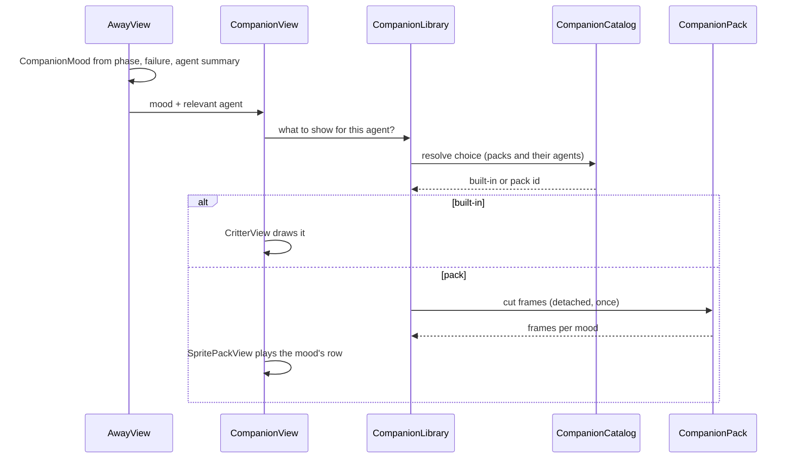

# Companions

## What the user does
Sees a companion on the away screen. By default it's "Match my agent": Ember for Claude Code, Pebble for Codex,
Prism for Cursor, Comet for Gemini CLI, Drift for Antigravity, Gremlin for Grok (Ember when no agent has been seen).
In Settings → Companion they can pick one of the six, or press **Add companion pack…** and choose a folder with a
Codex pet (`pet.json` + spritesheet); it's checked, copied into the companions folder and selected. A live preview
shows the current pick. **Show companions folder** opens it in Finder; broken packs are listed with the reason.
The companion acts out a mood: snoozing (nobody around), busy (agent working), "!" (agent needs you), celebrating
(agent finished), "hi!" (someone touched the Mac), "?!" (wrong password or locking for real).

## Types involved, in order
Choosing: `SettingsView` (companion section) → `CompanionLibrary` (stores `CompanionCatalog.Choice`) →
`CompanionPackLibrary` (import, scan) → `CompanionPack` (validate).
Showing: `AwayView` → `CompanionMood` (from `AwayController`'s phase and failure flag plus `AgentMonitor`'s summary)
→ `CompanionView` → `CompanionLibrary` resolves with `CompanionCatalog` (agent from `AgentMonitor`) →
`CritterView` with a `CritterDesign`, or `SpritePackView` with frames cut by `CompanionPack`.

## States and edge cases
- Mood priority (`CompanionMood`): locking for real or a failure in the last 3 seconds → oops; unlocking →
  greeting; else waiting / working / finished from the agent summary; else resting.
- Codex rows used: resting 0 (idle), greeting 3 (waving), finished 4 (jumping), oops 5 (failed), waiting 6, working
  7 (running). A mood with no drawn frames plays the idle row. Blank cells are skipped.
- Resolving: a chosen built-in or pack is used if it still exists; otherwise "match my agent". Matching prefers a
  pack whose `agents` lists the agent (alphabetically first), then that agent's built-in.
- Agent for matching: the summary's session, else the newest session, else the last agent seen since launch.
- Pack checks: `pet.json` decodes; spritesheet exists, stays inside the folder, is at most 20 MB, and is exactly
  1536×1872 (v1) or 1536×2288 (v2). Size is read from the image header; full decode only happens when shown.
- Importing a folder with the same name replaces the old copy.
- Frames are scaled smoothly (`.high` interpolation); pixel-art packs look slightly soft.

## Gotchas
- Built-in art is code, not images: change `CritterDesign` and check with the debug contact sheet
  (`BRBUDDY_COMPANION_SHEET`). Keep them original: no vendor mascots, logos or look-alikes.
- Third-party Codex pets often have non-commercial art licences (awesome-codex-pet's art is CC BY-NC 4.0). Users may
  install them for themselves; BRBuddy must never bundle them.
- Tested 2026-11-20: all 385 catalogue pets loaded with no problems; one was shown on the away screen, then removed.

## Code to check
Function names change: read the current code in these files before relying on any detail above.
- `CompanionLibrary.swift`, `CompanionView.swift`, `CritterView.swift`, `CompanionContactSheet.swift`,
  `SettingsView.swift`, `AwayView.swift`, `CompanionMood.swift`, `CompanionCatalog.swift`, `CompanionPack.swift`
- Types: `CompanionLibrary`, `CompanionView`, `SpritePackView`, `CritterView`, `CritterDesign`, `CompanionMood`,
  `CompanionCatalog`, `CompanionPack`, `CompanionPackLibrary`, `AwayController`, `AgentMonitor`
- Tests: `CompanionMoodTests`, `CompanionCatalogTests`, `CompanionPackTests`
