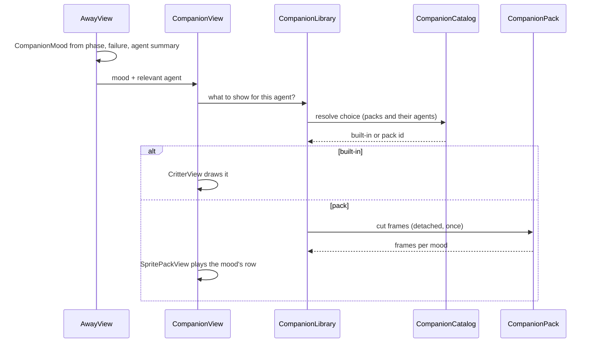

# Companions

## What the user does
Sees a companion on the away screen. By default it's "Match my agent": Ember for Claude Code, Pebble for Codex,
Prism for Cursor, Comet for Gemini CLI, Drift for Antigravity, Gremlin for Grok (Ember when no agent has been seen).
In Settings → Companion they can pick one of the six, or press **Add companion pack…** and choose a folder with a
Codex pet (`pet.json` + spritesheet); it's checked, copied into the companions folder and selected. A live preview
shows the current pick. **Show companions folder** opens it in Finder; broken packs are listed with the reason.
The companion acts out a mood: snoozing (nobody around), busy (agent working), "!" (agent needs you), celebrating
(agent finished), "hi!" (someone touched the Mac), "?!" (wrong password or locking for real).

## Types involved, in order
Choosing: `SettingsView` (companion section) → `CompanionLibrary` (stores `CompanionCatalog.Choice`) →
`CompanionPackLibrary` (import, scan) → `CompanionPack` (validate).
Showing: `AwayView` → `CompanionMood` (from `AwayController`'s phase and failure flag plus `AgentMonitor`'s summary)
→ `CompanionView` → `CompanionLibrary` resolves with `CompanionCatalog` (agent from `AgentMonitor`) →
`CritterView` with a `CritterDesign`, or `SpritePackView` with frames cut by `CompanionPack`.

## States and edge cases
- Mood priority (`CompanionMood`): locking for real or a failure in the last 3 seconds → oops; unlocking →
  greeting; else waiting / working / finished from the agent summary; else resting.
- Codex rows used: resting 0 (idle), greeting 3 (waving), finished 4 (jumping), oops 5 (failed), waiting 6, working
  7 (running). A mood with no drawn frames plays the idle row. Blank cells are skipped.
- Resolving: a chosen built-in or pack is used if it still exists; otherwise "match my agent". Matching prefers a
  pack whose `agents` lists the agent (alphabetically first), then that agent's built-in.
- Agent for matching: the summary's session, else the newest session, else the last agent seen since launch.
- Pack checks: `pet.json` decodes; spritesheet exists, stays inside the folder, is at most 20 MB, and is exactly
  1536×1872 (v1) or 1536×2288 (v2). Size is read from the image header; full decode only happens when shown.
- Importing a folder with the same name replaces the old copy.
- Frames are scaled smoothly (`.high` interpolation); pixel-art packs look slightly soft.

## Boops (clicking the companion)
- Clicking the companion on the away screen or in Settings' preview plays a reaction: `CompanionView` asks
  `BoopPicker` for the next `Boop`, plays its sound through `BoopPlayer` (unless `AwaySettings` turns boop sounds
  off) and shows it for about a second.
- Six reactions: five every companion shares, squish ("boop!"), giggle ("hehe"), spin ("wheee"), love (heart eyes)
  and grumpy ("hey!"), plus a signature one (star eyes, a jump, a rainbow burst) with the companion's own sound and
  line (`BoopSignature`). Each built-in has its own (Ember "fwoosh!", Pebble "plink", Prism a shimmer, Comet "zoom!",
  Drift "whooo", Gremlin "nyehehe"); a pack names one in `pet.json` (`boopSignature`, `boopBubble`), else it gets
  `sparkle`. The five friendly ones (signature included) come in a shuffled order, each once before any repeats and
  never twice in a row; five clicks within three seconds makes it grumpy.
- Built-in critters show the reaction's own face (`CritterView`); packs play a matching mood row instead. Both get
  the motion and `BoopFlair`'s effects and bubble. A boop moves the body even on battery.
- Sounds are synthesised in code by `BoopSound` (no sound files). On the away screen, the click also brings up the
  unlock prompt as before.

## Shuffle
- **Shuffle (a new one each BRB)** in the picker makes `CompanionLibrary` keep a `CompanionShuffle`: every built-in
  and pack in a shuffled order, each shown once before any repeats, never the same one twice in a row.
- `AppState` moves it on each time BRB starts (menu, shortcut, auto-start, walk-away all go through it), so the
  companion stays the same for the whole BRB. **Next companion** in Settings moves it on by hand.
- Its position is saved (`companion.shuffle.*`), so it carries on after a relaunch; packs that have gone are skipped
  and new ones join the next round.

## Companion Studio (making your own)
- **Settings → Companion → Companion Studio…** opens `CompanionStudioView` in its own window. The user picks a
  shape, two body colours, ears, an extra (sprout, star freckles, wisps, snaggle tooth), face options, a mouth
  (standard, cat ω, big grin, tongue out, fangs or beak, each still changing with the mood) and its size, floating, a
  signature sound and a line; blush on or off and its colour; designs saved before mouths or blush colours existed load with the standard mouth
  and pink cheeks; **Surprise me** makes a random `StudioDesign` with matching colours.
- The preview is a `CompanionView` given the design directly: it plays every mood and can be booped.
- **Save** renders both spritesheets (`StudioSheetRenderer` draws `CritterView` at fixed moments, 8 frames per
  mood, each row covering one loop of its main motion), then `StudioPackWriter` writes `design.json`, `pet.json`
  and the sheets into the companions folder (a new folder per name, "-2" if taken; editing keeps its folder).
  "Use it as my companion" then picks it.
- In BRBuddy a pack with `studioDesign` in `pet.json` is drawn live by `CritterView`, so it gets every reaction a
  built-in gets (battery, holding still, boop faces). Other pet apps use its sheets. **Edit …** in the Studio's
  menu reopens any saved design.

## Gotchas
- Built-in art is code, not images: change `CritterDesign` and check with the debug contact sheet
  (`BRBUDDY_COMPANION_SHEET`). Keep them original: no vendor mascots, logos or look-alikes.
- Third-party Codex pets often have non-commercial art licences (awesome-codex-pet's art is CC BY-NC 4.0). Users may
  install them for themselves; BRBuddy must never bundle them.
- Tested 2026-11-20: all 385 catalogue pets loaded with no problems; one was shown on the away screen, then removed.

## Code to check
Function names change: read the current code in these files before relying on any detail above.
- `CompanionLibrary.swift`, `CompanionView.swift`, `CritterView.swift`, `CompanionContactSheet.swift`,
  `SettingsView.swift`, `AwayView.swift`, `CompanionMood.swift`, `CompanionCatalog.swift`, `CompanionPack.swift`
- Battery reactions (plugging in, low battery, Low Power Mode) add props and can briefly change the mood: see
  `flows/battery.md`.
- Boops: `Boop.swift`, `BoopView.swift`; types `Boop`, `BoopPicker`, `BoopEvent`, `BoopSound`, `BoopPlayer`,
  `BoopFlair`, `BoopSignature`; tests `BoopTests`.
- Studio: `StudioDesign.swift`, `CompanionStudio.swift`; types `StudioDesign`, `StudioPackWriter`,
  `CompanionStudioView`, `StudioSheetRenderer`; tests `StudioDesignTests`.
- Shuffle: type `CompanionShuffle`; tests `CompanionShuffleTests`.
- Types: `CompanionLibrary`, `CompanionView`, `SpritePackView`, `CritterView`, `CritterDesign`, `CompanionMood`,
  `CompanionCatalog`, `CompanionPack`, `CompanionPackLibrary`, `AwayController`, `AgentMonitor`
- Tests: `CompanionMoodTests`, `CompanionCatalogTests`, `CompanionPackTests`
