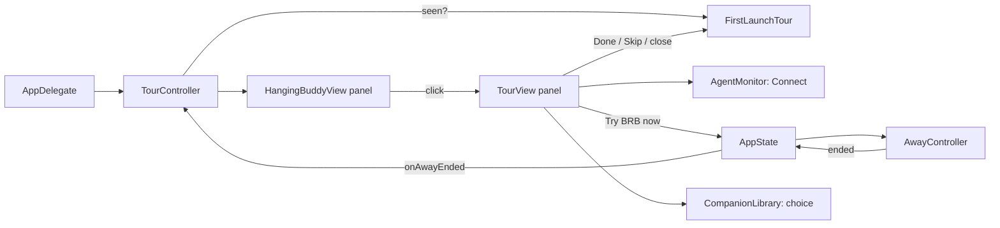

# First-launch tour

## What the user does
The first time BRBuddy opens, its companion drops down on a string under the paw icon in the menu bar, swaying, with
a bubble: "Hi! I live up here in your menu bar. Click me for a quick tour." Clicking the companion opens a small tour
panel under it, with four steps:

1. **Connect your agent:** the agents found on this Mac, each with a Connect button (the same hook setup as Settings →
   Agents).
2. **Try BRB:** what BRB does and how to come back (Touch ID or password), the shortcut, and the idle auto-start.
   **Try BRB now** covers the screen for real; after unlocking, the companion and the tour come back at step 3.
3. **Pick a companion:** a live preview (click it to boop) and the same choice as Settings → Companion, plus
   Companion Studio and a link to the gallery.
4. **A few extras:** launch at login, keep awake while an agent works, and the walk-away lock (opens Settings).

Then "You're all set": the paw is where everything lives. **Done** (or **Skip tour**, the panel's close button, or
the × on the companion's bubble) ends it: the companion says "See you up there!" and climbs back up. **Show tour
again** in the menu runs it again.

## Types involved, in order
`AppDelegate` finishes launching → `TourController` checks `FirstLaunchTour` (not seen yet) → after 1.5 s it finds
the menu bar item's window and its screen, places a clear borderless panel with `HangingBuddyView` under it
(`FirstLaunchTour`'s placement) → a click opens a titled panel with `TourView` just below → each step reads and
changes the same objects Settings uses (`AgentMonitor`, `AppState`, `CompanionLibrary`) → **Try BRB now** hides
both panels and calls `AppState` to start BRB → `AwayController` ends → `AppState`'s away-ended callback →
`TourController` shows both panels again at the companion step → finishing marks the tour seen.

## States and edge cases
- Seen means finished, skipped or closed. Quitting before doing any of those shows it again next launch.
- If the menu bar item can't be found or isn't visible (behind the notch, or hidden by a menu bar organiser), both
  panels go in the upper middle of the main screen instead.
- The hanging companion's panel floats at status-bar level on every Space and never takes focus; the tour panel is
  a normal floating panel that can be dragged.
- The tour doesn't open while BRB is up.
- Where the companion hangs is worked out once, when the tour opens, and reused when it comes back after the BRB
  demo (the menu bar is still reappearing then, so the item can't be found yet).
- Connect only changes an agent's settings when pressed, like Settings → Agents.

## Gotchas
- The menu bar item's window is found by its AppKit class name (`NSStatusBarWindow`), since SwiftUI's
  `MenuBarExtra` doesn't hand out its status item. If a macOS update renames it, the tour falls back to the middle of
  the screen rather than failing.
- Debug builds: `BRBUDDY_TOUR=1` forces the tour; `BRBUDDY_TOUR_SNAPSHOTS=<dir>` renders the companion and each step.

## Code to check
Function names change: read the current code in these files before relying on any detail above.
- `FirstLaunchTour.swift`, `TourController.swift`, `TourView.swift`, `AppDelegate.swift`, `AppState.swift`,
  `MenuContent.swift`, `BRBuddyApp.swift`, `AgentMonitor.swift`, `CompanionLibrary.swift`, `CompanionView.swift`
- Types: `FirstLaunchTour`, `TourController`, `HangingBuddyView`, `TourView`, `AppDelegate`, `AppState`,
  `MenuContent`, `AgentMonitor`, `CompanionLibrary`, `CompanionView`
- Tests: `FirstLaunchTourTests`
