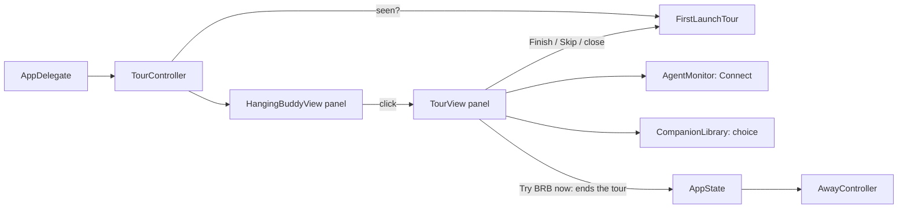

# First-launch tour

## What the user does
The first time BRBuddy opens, its companion drops down on a string under the paw icon in the menu bar, swaying, with
a bubble: "Hi! I live up here in your menu bar. Click me for a quick tour." Clicking the companion opens a small tour
panel under it, with four steps:

1. **Connect your agent:** the agents found on this Mac, each with a Connect button (the same hook setup as Settings →
   Agents).
2. **Pick a companion:** a live preview (click it to boop) and the same choice as Settings → Companion, plus
   Companion Studio and a link to the gallery.
3. **A few extras:** launch at login, keep awake while an agent works, and the walk-away lock (opens Settings at
   Walk-away).
4. **Try BRB:** what BRB does, how to come back (Touch ID or password), that the paw is where it lives, the shortcut
   and the idle auto-start. **Try BRB now** ends the tour and covers the screen for real; nothing reopens after
   unlocking.

**Finish** on the last step (or **Skip tour**, the panel's close button, or the × on the companion's bubble) ends
it without BRB: the companion says "See you up there!" and climbs back up. If the companion isn't clicked within
15 seconds, it does the same by itself. **Show tour again** in the menu runs it again.

## Types involved, in order
`AppDelegate` finishes launching → `TourController` checks `FirstLaunchTour` (not seen yet) → after 1.5 s it finds
the menu bar item's window and its screen, places a clear borderless panel with `HangingBuddyView` under it
(`FirstLaunchTour`'s placement) → a click opens a titled panel with `TourView` just below → each step reads and
changes the same objects Settings uses (`AgentMonitor`, `AppState`, `CompanionLibrary`) → **Try BRB now** marks the
tour seen, closes both panels and, a moment later, asks `AppState` to start BRB. Finishing any other way marks it
seen too.

## States and edge cases
- Seen means finished, skipped, closed or left unclicked for 15 seconds (`FirstLaunchTour`'s hang time). Quitting
  before any of those shows it again next launch.
- If the menu bar item can't be found or isn't visible (behind the notch, or hidden by a menu bar organiser), both
  panels go in the upper middle of the main screen instead.
- The hanging companion's panel floats at status-bar level on every Space and never activates BRBuddy; the tour
  panel is a normal floating panel that can be dragged.
- The tour doesn't open while BRB is up.
- The paw counts as hidden when it's off screen, below the menu bar, or behind the notch (`FirstLaunchTour` checks
  it against the screen's areas beside the notch).
- Connect only changes an agent's settings when pressed, like Settings → Agents.

## Gotchas
- BRBuddy owns its menu bar item (`StatusItemController`), so the paw's position comes straight from its status
  item. (Until 0.1.2 it was SwiftUI's `MenuBarExtra`, found by a hidden window's class name, which broke on Tahoe
  after the BRB demo.)
- Try BRB is the last step on purpose: BRB hides the menu bar and Dock, and anything reopened right after it has to
  find the paw while the menu bar is still coming back. Ending the tour first means nothing does. `FirstLaunchTourTests`
  checks it stays last.
- The hanging panel can become key and its hosting view takes the first click (both private to
  `TourController.swift`). Without that, a borderless panel in an app that isn't in front swallows every click, so
  the companion couldn't be clicked after an install or update (0.1.4 and earlier); it worked when started from
  Terminal only because BRBuddy was in front. The bubble's × uses a fixed dark colour so it shows in dark mode.
- Debug builds: `BRBUDDY_TOUR=1` forces the tour; `BRBUDDY_TOUR_SNAPSHOTS=<dir>` renders the companion and each step.

## Code to check
Function names change: read the current code in these files before relying on any detail above.
- `FirstLaunchTour.swift`, `TourController.swift`, `TourView.swift`, `AppDelegate.swift`, `AppState.swift`, `AppWindows.swift`,
  `StatusItemController.swift`, `BRBuddyApp.swift`, `AgentMonitor.swift`, `CompanionLibrary.swift`, `CompanionView.swift`
- Types: `FirstLaunchTour`, `TourController`, `HangingBuddyView`, `TourView`, `AppDelegate`, `AppState`,
  `StatusItemController`, `AgentMonitor`, `CompanionLibrary`, `CompanionView`
- Tests: `FirstLaunchTourTests`
