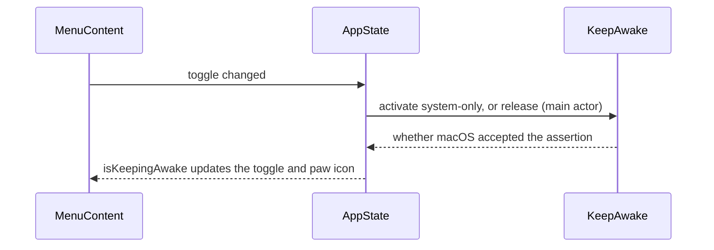

# Keep awake

## What the user does
Clicks the paw in the menu bar and ticks "Keep Mac awake". The paw fills in. Unticking it (or quitting BRBuddy) lets
the Mac sleep normally again.

## Types involved, in order
`MenuContent` → `AppState` → `KeepAwake` → IOKit power assertion.

## States and edge cases
- The menu toggle uses the "system only" mode: the Mac stays awake but the screen may turn off. "System and display"
  is for the away screen (Phase 1).
- If macOS refuses the assertion, `AppState` leaves keep-awake off, so the toggle falls back to unticked.
- Quitting or crashing releases the assertion (macOS drops a process's assertions when it exits).
- Lid closed on battery: macOS still sleeps. Not handled yet.

## Gotchas
- Switching mode releases the old assertion before creating the new one, so there's never more than one.

## Code to check
Function names change: read the current code in these files before relying on any detail above.
- `MenuContent.swift`, `AppState.swift`, `KeepAwake.swift`
- Types: `MenuContent`, `AppState`, `KeepAwake`
- Tests: `KeepAwakeTests`
