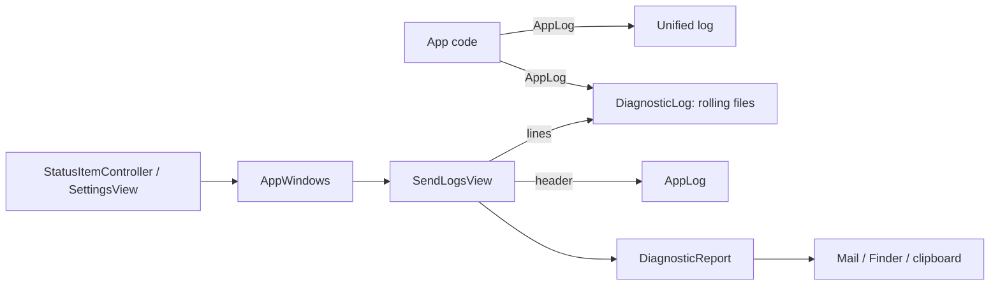

# Send logs

## What the user does
Something goes wrong on their Mac. They click the paw → **Send Logs…** (or Settings → General → **Send Logs…**). A
window shows the whole report that would be sent: BRBuddy's version, macOS, the Mac model and screens, a few
settings, then BRBuddy's recent log. They pick one:

- **Email to BRBuddy…** opens their mail app with a new email to hello@dhaataa.com and the report attached; they
  add what happened and send it. Without a mail app set up, a blank email opens and Finder shows the file to attach.
- **Save for GitHub…** saves the report as a text file and shows it in Finder, to attach to a GitHub issue.
- **Copy** copies the report. **Clear Log** deletes the log on this Mac.

Nothing is sent by itself.

## Types involved, in order
While the app runs, code across the app calls `AppLog`, which writes each line to macOS's unified log and to
`DiagnosticLog` (`LogRedaction` runs on every line first). From the menu (`StatusItemController`) or Settings
(`SettingsView`), `AppWindows` opens `SendLogsView` → it asks `AppLog` for the header and `DiagnosticLog` for the
log, and `DiagnosticReport` puts them together → Email uses the macOS "compose email" sharing service; Save writes
the report next to the log and reveals it.

## What's logged
- **app:** launch (version, macOS, screen count), quit, open at login changes and failures, Send Logs actions.
- **tour:** where the paw, screen and hanging panel are; whether a click reached the panel; the tour opening, each
  step, closing, timing out, Try BRB.
- **menu:** each item chosen (agent rows as "Claude Code session", without the project).
- **windows:** Settings (and which tab), Companion Studio, Send Logs.
- **away:** BRB starting and why (menu, shortcut, idle, walk-away, tour), failed unlocks (Touch ID or password, never
  what was typed), locking for real, the lock not taking, BRB ending.
- **agents:** a session's activity changing (agent and event only), connecting and disconnecting, listener errors.
- **walkAway:** Bluetooth state, the device's near/away state, locking the Mac.
- **updates:** update found, up to date, check ended, installing.
- **keepAwake:** turned on or off; macOS refusing the assertion.

## States and edge cases
- Four files of 512 KB at most: when `brbuddy.log` would pass that, it becomes `brbuddy.1.log` and the oldest goes.
- The report is rebuilt each time the window becomes key, so it's current.
- Saved reports stay in the Logs folder until the user deletes them; Clear Log removes only the log files.
- Copies built from source log too (their version says "Development build").

## Gotchas
- Never log what the user typed, terminal or mirror text, notes, prompts, project names or folders. `LogRedaction`
  is a backstop for paths and email addresses, not permission to log them.
- Agent events can arrive on every tool call; `AgentMonitor` logs only when a session's activity changes, so the
  log isn't flooded and older lines (like the tour's) survive.
- The tour logs clicks from AppKit, before SwiftUI sees them, so a report shows whether a click reached the
  companion at all (the 0.1.6 Tahoe bug was clicks falling through).
- Debug builds: `BRBUDDY_SEND_LOGS=1` opens the window.

## Code to check
Function names change: read the current code in these files before relying on any detail above.
- `DiagnosticLog.swift`, `AppLog.swift`, `SendLogsView.swift`, `AppWindows.swift`, `StatusItemController.swift`, `SettingsView.swift`
- Types: `DiagnosticLog`, `LogRedaction`, `DiagnosticReport`, `AppLog`, `SendLogsView`, `AppWindows`
- Tests: `DiagnosticLogTests`
