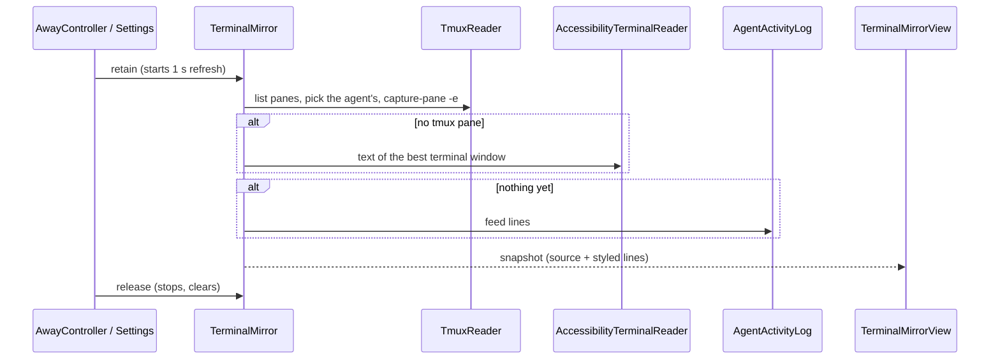

# Terminal mirror

## What the user does
In Settings → "Terminal on the away screen" they pick Off (default), Automatic, tmux pane, Terminal window or Agent
activity feed. A live preview shows what BRB will display, with the reason when there's nothing to show, a button
to allow Accessibility when a terminal window is wanted, and a warning that anyone at the Mac can read it. When BRB
is up, the companion shrinks and a dark "read-only" panel shows the latest lines that fit, labelled with its source
("tmux work:1.0 · brbuddy", "Terminal · brbuddy — claude", "Agent activity").

## Types involved, in order
`SettingsView` (mirror section) → `TerminalMirror` (mode stored as `TerminalMirrorMode`) → once a second, off the
main thread: `TmuxReader` → `ANSIParser`, or `AccessibilityTerminalReader` → `ANSIParser` (plain), or
`AgentMonitor`'s `AgentActivityLog` → snapshot → `TerminalMirrorView` in `AwayView` and Settings.
`AwayController` retains the mirror while BRB is up; the Settings section retains it while open.

## States and edge cases
- Automatic tries tmux, then a terminal window (only if Accessibility is allowed), then the feed; the specific modes
  try only their source. With nothing to show, the status lists every reason ("tmux isn't installed; BRBuddy isn't
  allowed to read terminal windows…").
- tmux: found at /opt/homebrew/bin, /usr/local/bin or /usr/bin. Pane choice (`TmuxReader`): agent command in the
  agent's folder → any agent command (including a version-number command, which is how Claude Code appears) → the
  agent's folder → the active pane → the first. Captures only the visible pane; each tmux call times out at 2 s.
- Terminal window: Terminal, iTerm2, Ghostty in that order; a window whose title contains the agent's folder name,
  else the main window, else the first; last 80 non-blank lines; 0.5 s AX timeout. Plain text only.
- Feed: last 80 events, repeats collapsed; prompts appear only as "got a new prompt"; tool details are truncated to
  140 characters.
- The away screen hides the panel when there's no snapshot (mirror off or nothing found).
- Ad-hoc-signed rebuilds change the app's signature, so macOS may forget the Accessibility permission after a
  rebuild; Developer ID signing (Phase 5) fixes that for releases.

## Gotchas
- Display-only by construction: tmux is only asked to list and capture; AX is only read; the view is plain text.
- Showing a terminal on a lock screen can expose secrets in it; that's why it's opt-in with a warning.
- Tested 2026-11-20 with the activity feed on the away screen (fake events through the real helper). tmux isn't
  installed on the dev Mac (fixture tests only); Accessibility wasn't granted (not live-tested).

## Code to check
Function names change: read the current code in these files before relying on any detail above.
- `TerminalMirror.swift`, `TerminalMirrorView.swift`, `AccessibilityTerminalReader.swift`, `SettingsView.swift`,
  `AwayView.swift`, `AwayController.swift`, `TerminalText.swift`, `TmuxReader.swift`, `AgentActivityLog.swift`,
  `TerminalMirrorMode.swift`, `AgentEvent.swift`
- Types: `TerminalMirror`, `TerminalMirrorView`, `AccessibilityTerminalReader`, `ANSIParser`, `TerminalColor`,
  `TerminalStyle`, `TerminalRun`, `TmuxReader`, `AgentActivityLog`, `TerminalMirrorMode`, `AgentMonitor`
- Tests: `ANSIParserTests`, `TmuxReaderTests`, `ActivityFeedTests`, `MirrorModeTests`
